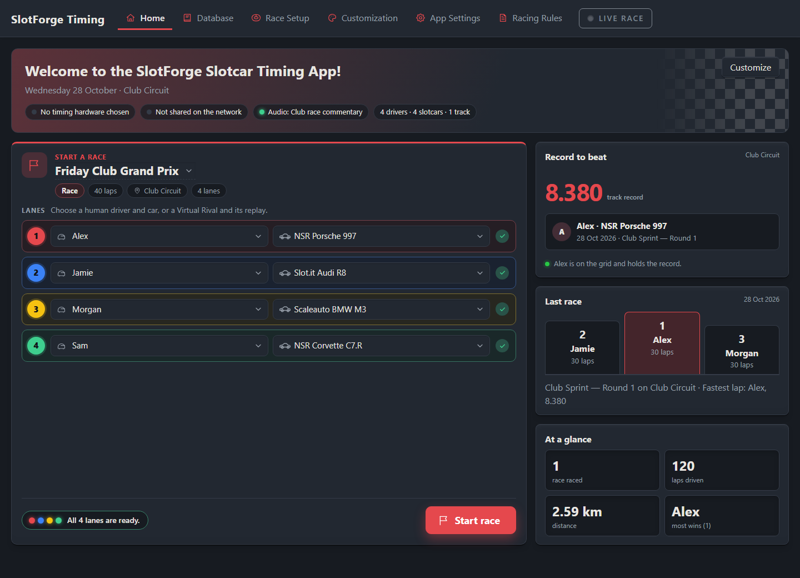
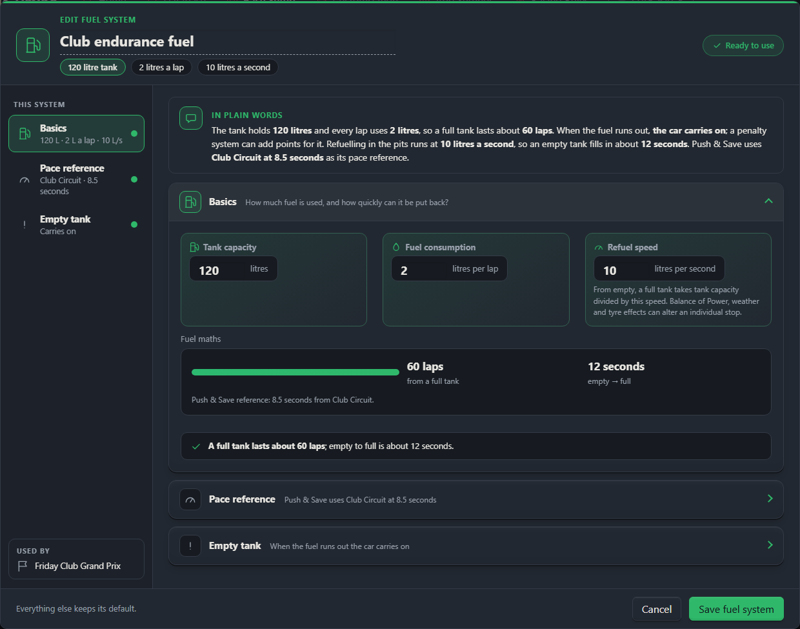
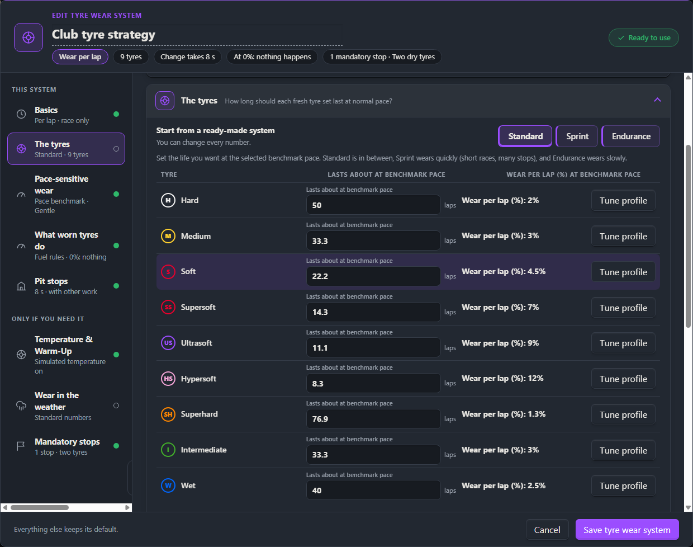
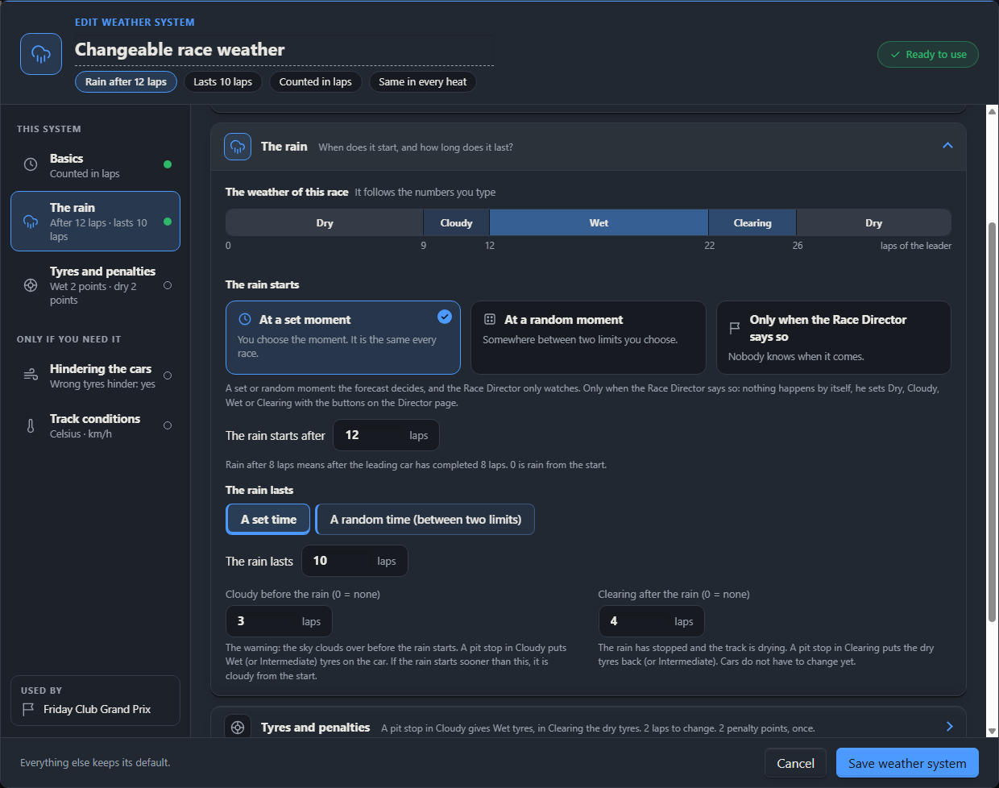
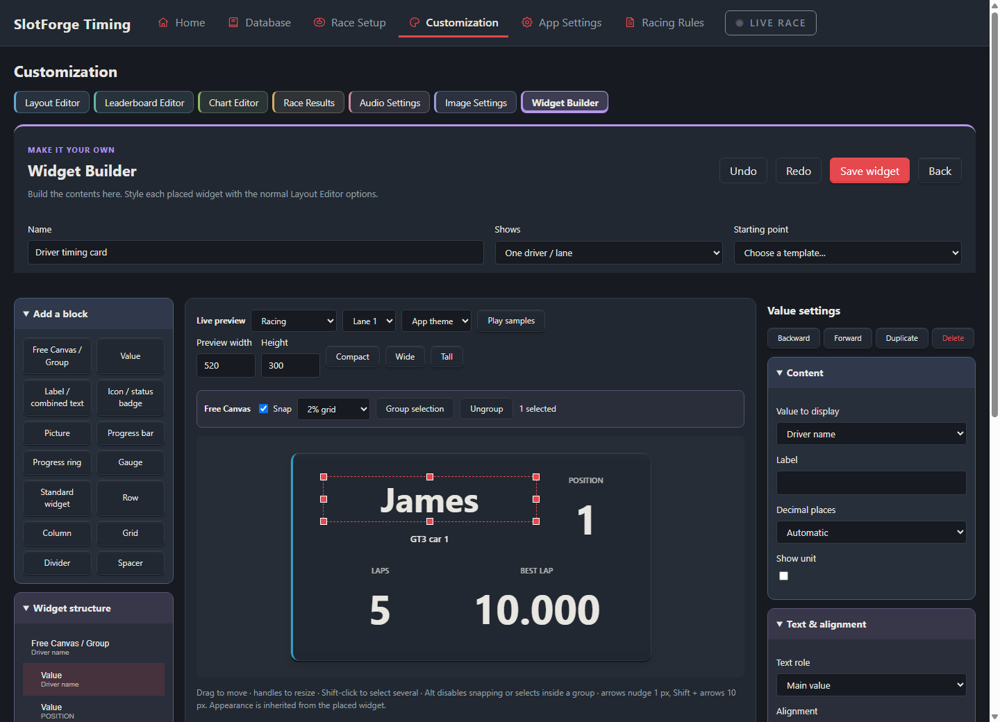
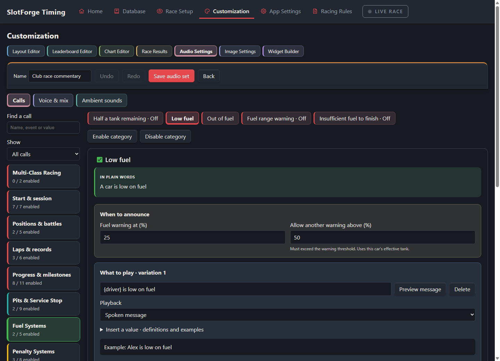
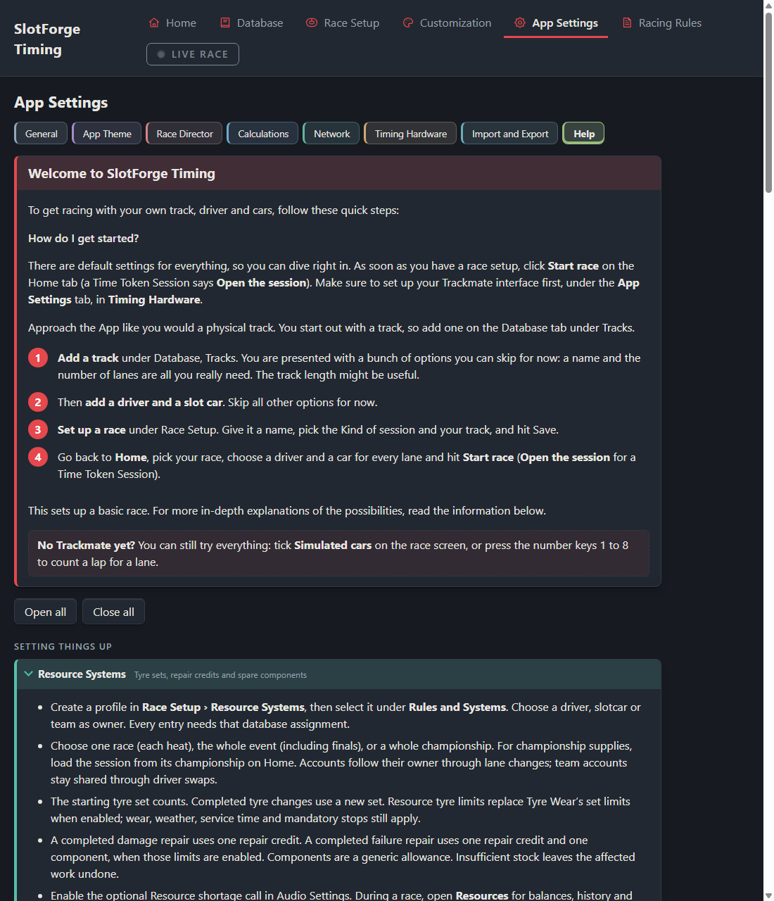

# SlotForge Timing


**Lap timing, race management and custom race displays for analogue slot-car tracks.**

SlotForge Timing brings your track, drivers, cars and race rules together in a desktop app. Run practice sessions, qualifying, club races, heats, championships and team endurance events, then review and publish the results. Build a simple timing screen or a complete race-day dashboard for a second monitor or TV.

**Current version: 1.99.4.** This repository contains the application source, build scripts, firmware sources and automated tests. See the [changelog](CHANGELOG.md) for this release.

**Ready to try it?** Download the Windows 64-bit [Portable executable](https://github.com/theDutchmanJames/SlotForgeTiming/releases/download/v1.99.4/SlotForge.Timing-1.99.4-Portable.exe), double-click it and explore the app. If you like it and want SlotForge for regular, long-term use, download the [Setup installer](https://github.com/theDutchmanJames/SlotForgeTiming/releases/download/v1.99.4/SlotForge.Timing-1.99.4-Setup.exe). Both are available in the [1.99.4 release downloads](https://github.com/theDutchmanJames/SlotForgeTiming/releases/tag/v1.99.4); neither needs Node.js.

**On this page:** [Features and Race Systems](#what-you-can-do-with-slotforge) · [Timing hardware](#timing-hardware) · [Install and run](#install-and-run) · [First race](#first-race) · [Development](#development-and-testing)

[](docs/screenshots/home.png)

*Home with sample club-race data. Select any screenshot to open its full-size image.*

## What you can do with SlotForge

Use SlotForge for a few laps on your home track or a complete club race meeting. Start with basic timing, then choose the extra rules, displays and announcements that suit your event.

### Race formats and competition management

- Run **Free Practice, Qualifying, Races, Heat-based races, Endurance Races and Time Token Sessions**.
- Set races to end by time, laps or distance, with configurable start lights, first-lap behaviour, track calls and red-flag restarts.
- Plan heats and lane rotations, combine results, organise championship rounds and award points.
- Run teams with driver swaps, mixed car classes or recorded Virtual Rivals.
- Review the finished session as Race Director: invalidate or remove laps, disqualify entries and finalise the classification before saving it.
- Show a **Victory Spotlight**, podium cards, configurable driver facts and comparison charts on the Results screen. For larger fields, use a saved leaderboard design.
- Keep personal bests and track records. Laps interrupted by a red flag are marked invalid for records, so coasting during a stoppage cannot create an artificial personal best or track record.

### Race Systems and what they do

Make reusable setups under **Race Setup**, then select the systems you want in a Race Setup. Each system adds its own rules to the shared race engine. You can keep a race simple or combine supported systems for a more strategic event; availability depends on the session format.

| System or setup | What it adds to your race |
| --- | --- |
| **Fuel Systems** | Set tank capacity, fuel consumption, refuelling speed and what happens when the tank runs empty. Use a track's target lap time or a manual reference to configure the system. |
| **Penalty Systems** | Award penalty points and decide their consequences: added time, lap adjustments, forced pit stops or custom combinations. Build escalating points tiers, named special penalties and disqualification rules. |
| **Safety Car Systems** | Configure yellow-flag target pace, penalties for driving too fast, pit-time adjustments and optional random flags with conditions. Track-call power behaviour follows the Race Setup. |
| **Tyre Wear Systems** | Choose standard or custom tyre compounds, wear/lifespan, tyre-changing time, weather suitability, mandatory stops, available sets and warnings. Faster or slower driving can change wear through the configured pace rules. |
| **Tyre Temperature & Warm-Up** | An optional part of Tyre Wear. Simulate cold, working and hot tyres, with compound-specific warm-up, cooling and wear effects. Weather, pits, pauses and completed tyre changes feed into the simulation. |
| **Weather Systems** | Simulate changing weather and track conditions, tyre suitability, wrong-tyre penalties and configurable race effects. Combine them with Tyre Wear, Fuel and other supported rules. |
| **Push & Save Systems** | Make pace affect fuel use, tyre wear or both. Faster laps can cost more resources; slower laps can save them. Set the Push/Save thresholds, benchmark and effect strength. |
| **Damage Systems & car failures** | Apply damage and supported failure events, determine the resulting hindrance, and require repairs or retirement/disqualification under your chosen rules. Repairs integrate with pit service. |
| **Balance of Power** | Help slower cars or hinder faster ones through fuel consumption, refuelling speed and optionally tank capacity. Supports director decisions and automatic balancing; it requires a Fuel System. |
| **Resource Systems** | Limit tyre sets, repair credits and replacement-component supplies for a driver, car or team. Track allocations across a race, event or championship and record director adjustments. |
| **Multi-Class Systems** | Race GT3s, Prototypes or your own classes together or in separate class heats. Select car classes, assign drivers, restrict eligible cars and keep overall/class classifications and points. |
| **Virtual Rival Systems** | Turn saved lap sequences into replay opponents. Link a setup to a Virtual driver, select that driver in a lane, and choose its replay instead of a slotcar. Replays follow the race clock and pause with it; physical timing inputs do not drive the virtual entry. |
| **Rotation Setups** | Build a reusable heat and lane-rotation plan so drivers or teams move through the event in the order you choose. |
| **Championship Setups** | Combine rounds and sessions into a competition with a roster, points tables, bonuses, dropped results, teams and tie-breaking rules. |
| **Time Tokens** | Give each lane an allowance of track time. Add or subtract time, set warnings and show when a lane's time expires. This is a timed-use session rather than a race with a winner; supported lane relays can control lane power. |
| **Endurance & driver swaps** | Race as a team, choose who is driving, define swap windows and minimum driving requirements, and track stints and swap penalties. These controls live in the Race Setup. |
| **Service Stop** | A Race Setup option that works independently of other Race Systems. Hold a pit stop while a car is removed for service, choose timed/manual release and combine fuel, tyres and repairs sequentially or in parallel. A fixed service timer can override calculated work time; penalty time remains additive. |

Tyres, fuel, damage, weather and related effects are race simulations. Their interaction is handled by SlotForge's rules; direct hardware actions depend on the interface and relays connected to your track.

| Fuel Systems | Tyre Wear Systems | Weather Systems |
| :---: | :---: | :---: |
| [](docs/screenshots/fuel.png) | [](docs/screenshots/tyre-wear.png) | [](docs/screenshots/weather.png) |

*Reusable Race System setups, each with its own colour and section rail. Open a preview to inspect the settings.*

### Completely freely customisable Race Screens

Build your own Race Screens in **Customization → Layout Editor**. Place, move, resize and layer widgets freely instead of being limited to a fixed dashboard. Create separate layouts for the **main screen** and **second display**, from a clean two-lane timing page to a large TV display with race statistics and graphics.

- Choose individual timing, driver, fuel, tyre, weather, penalty, strategy, team and race-control widgets.
- Use **All-in-One widgets** when you want essential driver, timing or race information together without arranging many separate pieces.
- Change fonts, title/value alignment, automatic or manual text sizing, backgrounds, one-colour gradients and gradient angles.
- Configure borders, rounded corners, depth and lane-colour accents at the top, left or right.
- Apply race-state colours to the background, text, or text and border.
- Use pictures, lane colours, shadows and front/back ordering to build the appearance you want.

### Widget Builder

Create reusable widgets in **Customization → Widget Builder**, starting with a blank canvas or a template. Add values, labels, pictures, icons, conditional status indicators, bars, rings, gauges and supported standard widget components.

Drag and resize individual elements in the live preview. Arrange them freely or use rows, columns, grids and groups. Browse grouped variables, format values and add rules that change an element when its data changes. Save the result, then place it in a Race Screen using the same appearance controls as the built-in widgets.

### Custom Audio Sets

Create different Audio Sets for different race nights or tracks. Configure spoken commentary, custom messages, recorded clips, sound effects and ambient sounds in **Customization → Audio Settings**.

Calls are grouped by race activity and Race System. Insert supported values such as driver names, lap times, positions, gaps and system status into messages. Choose playback modes, conditions, repeat limits, voice/mix options and which calls are enabled. Link the Audio Set to a Race Setup so the right announcements load with the event.

| Widget Builder | Custom Audio Sets |
| :---: | :---: |
| [](docs/screenshots/widget-builder.png) | [](docs/screenshots/audio-calls.png) |

*Create your own widget contents and race commentary. Both previews link to full-size screenshots.*

### Leaderboard Editor

Design the rows of your leaderboard: choose which values to show, their order, widths, labels, colours and presentation. Reuse a saved design in **Leaderboard widgets**, the **Live Race leaderboard** and the **Race Results list**. Configure overall, class-specific or grouped class views where supported.

### Chart Editor and live comparisons

Create a saved chart design in **Customization → Chart Editor**, then place a Race Chart widget in a layout or use it as a supported Widget Builder component. Choose drivers, values, lap history, references, legends and display options.

Chart styles include **Lap Trend, Driver Comparison, Delta Trend, Lap Time Spread (box plot), Lap Time Distribution (histogram), Position History, Lap Heatmap and Live Track**. Live Track shows estimated progress from lap timing; it is not a physical position sensor. It uses the shared, throttled display-update path rather than adding an unrestricted animation loop per chart.

### Custom Image Sets

Create reusable **Image Sets** in **Customization → Image Settings** and assign them to compatible widgets. Use your own artwork for supported elements such as driver avatars, tyres, start lights, fuel indicators and weather graphics. A saved set makes it easier to keep matching visuals across several layouts.

### Powerful app theming and personal branding

Make SlotForge look and feel like your own app. Choose a ready-made theme or give the app the colours you want, add your own **logo and header images**, and coordinate the Race Screens, widgets and image sets. Build a personal style for your home track, or match your **club or company branding**. The app's [licence terms](#licence-and-copyright) govern its use.

### Driver, Slotcar and Track Databases

Keep drivers, teams, slotcars and tracks together with their pictures, descriptions, class labels and settings. Track records and personal bests stay linked to the people, cars and tracks that produced them.

The **Slotcar Database** includes more than a car list. View laps driven, mileage, sessions, wins, last use, fastest laps, per-track lap statistics, service intervals and mileage/laps since servicing. Deslot estimates use the track's configured lap-time threshold. Set a **Race Class** label, such as GT3 or Prototype, to make the car available to the matching Multi-Class entries.

### SlotForge Track Builder and Paddock

Import a **SlotForge Track Builder** design into the Track Database, including its name, lane lengths, artwork and supported route/tuning data. The **Live Track** chart can follow that layout using either the original coloured-lane style or the imported artwork. Car movement remains an estimate based on lap timing and the supported tuning profile.

Open **Database → Slotcars → Connect to Paddock** to link cars from a **SlotForge Paddock** host on your local network. Use its address and separate Timing connection code, then create linked cars or match them to existing Timing cars. Catalogue specifications and Race Class come from Paddock; Timing keeps its simulation settings and local race history.

Reviewed, finalized results are queued for Paddock, including measured laps, mileage and overall classification. Cached configurations allow offline racing; reconnect to deliver waiting results. Corrections and withdrawals prevent duplicate or stale statistics. This requires a Paddock build with the **Timing v1 API**; the older v0.16.3 executable is not compatible. See the [connection guide and v1 limits](docs/PADDOCK-INTEGRATION.md).

### Import, Export and sharing between users

**App Settings → Import and Export** lets users freely share **Widgets, Layouts and custom Audio and Image Sets** with each other. Export a design or a collection, send the file to another user, and let them import it into their own app—there is no need to exchange the entire database.

You can also export drivers, slotcars, tracks, teams, Race System setups, championship setups, leaderboard designs, chart designs and saved sessions. Choose the related items to include, such as an Image Set used by a layout. **Individual imports add copies**, preserving links between the included items; a conflicting name gets an imported suffix.

For moving a complete installation's data, create a **Complete backup**. It includes the database, layouts, pictures, sounds, settings, past races and laps. **Restoring a complete backup replaces the current database**, so use an individual export when your aim is simply to add another user's designs. Complete backups also include settings such as the Race Director password; individual design exports are the appropriate files for sharing publicly.

### Content Packs and code plugins

**App Settings → Import and Export → Content Packs** lets you install and share collections of layouts, Widget Builder designs, leaderboard and chart designs, Image Sets, Audio Sets, colour themes and supported Race System presets. Review a pack, then add editable copies to your normal editors or explicitly apply its theme. Updates and removal preserve your existing copies. Create packs from your saved content without writing code.

Content Packs are a versioned collection-sharing workflow built on the existing importer, with compatibility checks, manual updates and library rollback. They do not add new app capabilities. **App Settings → Plugins** provides the first executable runtime: separately installed background JavaScript, generated settings, command buttons, logs, local storage and recovery. Installation does not run a plugin: start it explicitly only if you trust its code and author, as it has your operating-system access. Timing plugins can now supply lap/pit sensors, track calls and optional power/light outputs through **Timing Hardware → Plugin Interface**. See the [timing-driver guide](docs/PLUGIN-TIMING.md). Plugins can also contribute lane/race widgets, custom pages and tools. Add their widgets through the Layout Editor’s **Plugins** folder, and open **Customization → Plugin Pages & Tools** for their pages and explicit actions. Shared layouts keep plugin references but do not bundle executable code. See [Display API 1](docs/PLUGIN-DISPLAYS.md). Race Setups can also select a rule plugin for frozen fuel/tyre modifiers, lap-time consequences and competition-point bonuses. See [Rule API 1](docs/PLUGIN-RULES.md). Third-party code stays separate from SlotForge’s source and standard build. See [runtime API 1](docs/PLUGIN-RUNTIME.md). See the [plugin architecture plan](docs/PLUGIN-PLAN.md). Back up installed packs separately from the database; copied content is included in normal database backups. See the [content-pack guide and example](docs/content-packs.md).

### Expansive Help and a Calculations reference

The in-app **Help** has grouped, expandable sections covering race preparation, Race Systems, hardware, editors, results and day-to-day workflows. Setup pages also provide **IN PLAIN WORDS** summaries, explanations, tooltips and previews.

**App Settings → Calculations** explains the documented formulas and worked examples behind pace benchmarks, fuel, tyres, race effects, resource allocation, pit service, penalties, timing estimates and scoring. Explore available choices such as median or average pace and save supported calculation settings. The page distinguishes examples from settings that actually change race behaviour; it is not an unrestricted code editor.

[](docs/screenshots/help.png)

*Getting-started guidance and expandable Help topics are available inside the app.*

### Second screens, local-network viewing and race control

Display live timing and results on another monitor or TV, or let devices on the same local network follow a race in their browser. The Race Director can manage calls, penalties, pit service and supported Race System controls while racing. Remote director access uses the password configured in App Settings.

## Timing hardware

Choose the active interface in **App Settings → Timing Hardware**. One interface supplies race timing at a time.

| Interface | Support in this version |
| --- | --- |
| Trackmate | Serial connection, lane mapping, track calls and supported relay control. |
| SlotForge Arduino box | SlotForge firmware for compatible Nano/Mega boards, sensors, pits, lights, relays and buttons. A virtual box is available for simulation. |
| Parallel Port | Windows native LPT/compatible expansion hardware through a separately installed compatible InpOut driver. A USB printer adapter does not provide the required direct pin access. |
| Phidget | Local USB on Windows 64-bit through the official Phidget22 libraries; digital, voltage and voltage-ratio sensor inputs, plus supported outputs. |
| DS Electronics | Serial capture and diagnostics. Race timing is not implemented yet. |
| oXigen Digital | Reserved interface page; not implemented yet. |
| No hardware | Keyboard/manual controls and simulated cars for trying the app. |

Parallel Port and Phidget support have been tested in software with simulated inputs. Physical hardware compatibility and timing accuracy have not been verified for these implementations. Check the interface documentation before connecting a track:

- [Parallel Port setup and requirements](docs/PARALLEL-PORT.md)
- [Phidget setup and limitations](docs/phidget-interface.md)
- [Arduino box documentation](docs/arduino-box/)
- [Service Stop behaviour](docs/SERVICE-STOP.md)

## Install and run

### Which download should I use?

| Option | Best for | How you use it |
| --- | --- | --- |
| **Portable.exe** | Trying the app, checking its features or testing a new version. | Ready to use: download it and double-click. If supplied inside a ZIP, extract it first. No installation is required. |
| **Setup.exe installer** | Regular, long-term use once you are happy with the app. | Run the installer and follow its steps. It installs the app and can create shortcuts for convenient everyday use. |
| **Source ZIP** | Building the app yourself or working on its code. | Install Node.js, extract the source and run a build file. This produces the Portable and Setup programs. |

**Portable and installed builds do not need Node.js.** Both use the app's normal user-data folder on the computer, so Portable does not mean a separate database is stored beside the executable. Interface-specific drivers or libraries may still be needed for timing hardware.

### Ready-made Windows programs

Version **1.99.4** includes both ready-made Windows 64-bit executables in its [release downloads](https://github.com/theDutchmanJames/SlotForgeTiming/releases/tag/v1.99.4):

- **[Download Portable.exe](https://github.com/theDutchmanJames/SlotForgeTiming/releases/download/v1.99.4/SlotForge.Timing-1.99.4-Portable.exe)** — ready to use. Double-click it to test the app without installing it.
- **[Download Setup.exe](https://github.com/theDutchmanJames/SlotForgeTiming/releases/download/v1.99.4/SlotForge.Timing-1.99.4-Setup.exe)** — use the installer if you liked the app and want to keep using it long term.

Choose one of those executable files under **Assets**. The separate source ZIP and GitHub's automatic **Source code** downloads are for building the app yourself.

**To try SlotForge:**

1. Download the Portable program. Extract it first if it comes in a ZIP.
2. Double-click the downloaded **SlotForge.Timing-1.99.4-Portable.exe** file.
3. Explore with **No hardware**, manual controls or the Arduino virtual box before configuring your real timing interface.

**To keep using SlotForge:**

1. Download **SlotForge.Timing-1.99.4-Setup.exe**.
2. Double-click it and follow the installation steps.
3. Open SlotForge Timing using its shortcut. Use **Import and Export** for backups or moving your data to another PC.

The GitHub **Code → Download ZIP** button provides source files, not a ready-made program. If you do not see a Portable or Setup executable in your download, build the source as described next.

### Windows: build it without typing terminal commands

For new or inexperienced users, **Quick Build is the recommended way to make a program you can try**. It skips the automated test/check phase and goes straight to building after obtaining any missing dependencies. It creates the same Portable and Setup program formats as the normal build.

1. **Install Node.js.** Visit [nodejs.org](https://nodejs.org/), download the Windows installer and run it. Keep the npm and PATH options enabled. This source release was developed and checked with Node.js **24.x**. Close and reopen any terminals after installing it.
2. **Download the source.** On [the repository page](https://github.com/theDutchmanJames/SlotForgeTiming), click the green **Code** button and choose **Download ZIP**. You can also use a separately provided SlotForge source ZIP.
3. **Extract the ZIP.** Right-click the downloaded file, choose **Extract All**, and extract it to a normal writable folder, such as Documents. Do not run the build from inside the ZIP.
4. **Find the app folder.** Open the extracted folders until you can see **package.json**, **build-windows.bat** and **build-windows-quick.bat** together. GitHub downloads usually name this folder **SlotForgeTiming-main**; a separate source ZIP may contain **SlotForgeTiming**.
5. **Double-click build-windows-quick.bat.** Keep the build window open. The first run needs an internet connection to download dependencies; it can take several minutes. Quick Build skips the automated checks. If a filename's extension is hidden, Windows may show it as **build-windows-quick** with type **Windows Batch File**.
6. **Open the dist folder.** A successful build opens it automatically. You can also open **dist** yourself inside the app folder.
7. **Try Portable first.** In **dist**, double-click **SlotForge Timing-1.99.4-Portable.exe**. If you are happy and want to use the app long term, run **SlotForge Timing-1.99.4-Setup.exe**.

**What does Quick Build skip?** It skips `npm test`, the automated test suite. It still installs missing build dependencies and compiles/packages the app. The normal **build-windows.bat** runs the checks before building; developers and anyone validating changes can use that file instead.

### Windows: start the app from any terminal folder

**npm does not search your computer for SlotForge.** It runs against the project in the terminal's **current working folder**, using that project's `package.json` and `package-lock.json`. Opening a random terminal and entering `npm ci` is therefore not enough: you must first select SlotForge's extracted source folder.

The instructions below start from scratch. You do not need to have opened a terminal in the right folder or completed another terminal guide first.

#### 1. Install Node.js and extract the source

1. Install [Node.js](https://nodejs.org/) with npm and the PATH option enabled; this release was checked with Node.js **24.x**. Close and reopen terminals after installation.
2. Download the **source ZIP** and use **Extract All**. A ZIP open in File Explorer is not an extracted folder.
3. Open the extracted folders until **package.json**, **package-lock.json** and **build-windows-quick.bat** are visible together. GitHub downloads usually call this folder **SlotForgeTiming-main**; the separate release ZIP contains **SlotForgeTiming**. There may be an outer folder with another folder inside it: choose the inner app folder containing those files.
4. In that folder, click File Explorer's **address bar** to reveal the full path, then copy it. Copy the folder path, not the path of `package.json` itself. For example, a real path might look like `D:\Slotcar Projects\SlotForgeTiming-main`. Yours will usually be different.

#### 2. Open PowerShell, wherever it starts

Press **Windows + R**, type **powershell.exe -NoProfile**, and press **Enter**. Alternatively, if you already opened Command Prompt or another Windows terminal, type this and press Enter to open the PowerShell session used by this guide:

```text
powershell.exe -NoProfile
```

Its prompt usually starts with **PS**, for example `PS C:\Users\YourName>`. It is fine if it starts in a completely different folder or on a different drive. Do not type the `PS C:\...>` prompt itself.

#### 3. Paste the complete start block

Copy **all** of the following block, including `& {` and the final `}`, paste it into PowerShell, and press **Enter**. Do not enter the lines individually. The opening and closing braces keep the steps together so a folder or install error stops the later steps.

When it asks **Paste the full extracted SlotForge folder path**, paste the path you copied in step 1 and press **Enter**. You do not need to edit a username or placeholder path in the commands. Paths with spaces and paths on another drive are supported.

```powershell
& {
    $slotForgeFolder = (Read-Host "Paste the full extracted SlotForge folder path").Trim().Trim('"')
    if (-not $slotForgeFolder) { throw "No folder was entered. Run this block again and paste the folder path." }
    Set-Location -LiteralPath $slotForgeFolder -ErrorAction Stop
    if (-not (Test-Path -LiteralPath ".\package.json" -PathType Leaf)) { throw "Wrong folder: package.json is missing. Open the extracted app folder, not its parent or the ZIP." }
    $slotForgeProject = Get-Content -LiteralPath ".\package.json" -Raw -ErrorAction Stop | ConvertFrom-Json -ErrorAction Stop
    if ($slotForgeProject.name -ne "slotforge-timing") { throw "This is another project, not SlotForge Timing. Run this block again with the correct folder." }
    npm.cmd ci
    if ($LASTEXITCODE -ne 0) { throw "Dependency installation failed. Read the error above." }
    npm.cmd start
}
```

What happens next:

1. **Select the folder:** `Set-Location` moves this PowerShell session to the folder you supplied, even if it is on another drive. It does not move the source files.
2. **Check the project:** the block requires `package.json` and checks that its project name is `slotforge-timing`. If the folder is wrong, it stops before running npm.
3. **Install dependencies:** `npm.cmd ci` downloads the dependencies specified by that folder's lockfile. Wait for it to finish. If it fails, the block does not start the app.
4. **Open SlotForge:** `npm.cmd start` reads SlotForge's start command from the same `package.json` and opens the development app. Leave this terminal open while using it.

`npm.cmd` is npm's Windows launcher. It also works when PowerShell blocks `npm.ps1`; you do not need to change the execution policy.

**Next time:** run the complete block again from any terminal location, or, if you have kept this same PowerShell session open and it is still in the verified SlotForge folder, enter `npm.cmd start`. A newly opened terminal does not remember this session's folder—use the full block again.

### Windows: Quick Build from any terminal folder

For beginners, double-clicking **build-windows-quick.bat** in the extracted app folder is still the easiest route. If you prefer a terminal, use the self-contained block below.

Install Node.js, extract the source, and copy the full folder path containing **package.json** and **build-windows-quick.bat**. Open PowerShell with **Windows + R → powershell.exe -NoProfile**. Paste the whole block at once; when it asks for a path, paste your app folder and press Enter. The terminal may initially be in any folder.

```powershell
& {
    $slotForgeFolder = (Read-Host "Paste the full extracted SlotForge folder path").Trim().Trim('"')
    if (-not $slotForgeFolder) { throw "No folder was entered. Run this block again and paste the folder path." }
    Set-Location -LiteralPath $slotForgeFolder -ErrorAction Stop
    if (-not (Test-Path -LiteralPath ".\package.json" -PathType Leaf)) { throw "Wrong folder: package.json is missing. Open the extracted app folder, not its parent or the ZIP." }
    $slotForgeProject = Get-Content -LiteralPath ".\package.json" -Raw -ErrorAction Stop | ConvertFrom-Json -ErrorAction Stop
    if ($slotForgeProject.name -ne "slotforge-timing") { throw "This is another project, not SlotForge Timing. Run this block again with the correct folder." }
    & .\build-windows-quick.bat
}
```

Quick Build downloads any missing build dependencies and creates both executables in that app folder's **dist** directory. It **skips the automated checks**. Try the **Portable.exe** first; use the **Setup.exe** for long-term installation.

### Windows: build from the lockfile, without checks

This is an alternative to Quick Build for people who want to install the exact dependency versions in the lockfile. Install Node.js, extract the source, copy the app folder's full path, and open **PowerShell** with `powershell.exe -NoProfile`. Paste the complete block below. Supply the folder containing **package.json** when prompted; no particular starting folder is required.

```powershell
& {
    $slotForgeFolder = (Read-Host "Paste the full extracted SlotForge folder path").Trim().Trim('"')
    if (-not $slotForgeFolder) { throw "No folder was entered. Run this block again and paste the folder path." }
    Set-Location -LiteralPath $slotForgeFolder -ErrorAction Stop
    if (-not (Test-Path -LiteralPath ".\package.json" -PathType Leaf)) { throw "Wrong folder: package.json is missing. Open the extracted app folder, not its parent or the ZIP." }
    $slotForgeProject = Get-Content -LiteralPath ".\package.json" -Raw -ErrorAction Stop | ConvertFrom-Json -ErrorAction Stop
    if ($slotForgeProject.name -ne "slotforge-timing") { throw "This is another project, not SlotForge Timing. Run this block again with the correct folder." }
    npm.cmd ci
    if ($LASTEXITCODE -ne 0) { throw "Dependency installation failed. Read the error above." }
    npm.cmd run dist
}
```

The programs are written to **dist** inside the folder you supplied.

### Windows: run checks before building

Use this route to validate source changes. Install Node.js, extract the source, copy the full path of the app folder containing **package.json**, and open **PowerShell** with `powershell.exe -NoProfile`. Paste the complete block and supply that folder when asked. If the folder, dependency installation or checks fail, later steps do not run.

```powershell
& {
    $slotForgeFolder = (Read-Host "Paste the full extracted SlotForge folder path").Trim().Trim('"')
    if (-not $slotForgeFolder) { throw "No folder was entered. Run this block again and paste the folder path." }
    Set-Location -LiteralPath $slotForgeFolder -ErrorAction Stop
    if (-not (Test-Path -LiteralPath ".\package.json" -PathType Leaf)) { throw "Wrong folder: package.json is missing. Open the extracted app folder, not its parent or the ZIP." }
    $slotForgeProject = Get-Content -LiteralPath ".\package.json" -Raw -ErrorAction Stop | ConvertFrom-Json -ErrorAction Stop
    if ($slotForgeProject.name -ne "slotforge-timing") { throw "This is another project, not SlotForge Timing. Run this block again with the correct folder." }
    npm.cmd ci
    if ($LASTEXITCODE -ne 0) { throw "Dependency installation failed. Read the error above." }
    npm.cmd test
    if ($LASTEXITCODE -ne 0) { throw "Checks failed. The build has not been started." }
    npm.cmd run dist
}
```

### Optional: download with Git

Git is optional; ZIP downloads work without it. If you have [Git](https://git-scm.com/) and Node.js installed, this sequence creates the source folder for you, so there is no extracted source path to find.

1. Press **Windows + R**, type **cmd.exe**, and press Enter. These commands use **Command Prompt**, not PowerShell. From an existing terminal, type `cmd.exe` first.
2. Run this command to move to your Windows user folder, whichever folder or drive the terminal started in:

```bat
cd /d "%USERPROFILE%"
```

3. Download the repository and enter it only if the download succeeds, then run Quick Build:

```bat
git clone https://github.com/theDutchmanJames/SlotForgeTiming.git SlotForgeTiming-source && cd /d "%USERPROFILE%\SlotForgeTiming-source" && build-windows-quick.bat
```

`%USERPROFILE%` is your Windows user folder, such as `C:\Users\James`. `cd /d` changes both the drive and folder. `&&` runs the next command only when the preceding command succeeds. If **SlotForgeTiming-source already exists**, cloning stops: use the existing app folder and one of the path-prompt blocks above, or choose a different new folder name. Do not enter bare npm commands in the original terminal folder.

### Linux and macOS: select the source folder before commands

Build on the operating system you are targeting. Linux/macOS scripts are provided, but this release's desktop verification was performed on Windows and timing-interface availability differs by platform.

For **each block below**:

1. Install [Node.js](https://nodejs.org/) and extract the source ZIP.
2. Find the extracted app folder containing **package.json**, **package-lock.json** and the build scripts. Copy its full folder path from your file manager. On macOS, selecting the folder in Finder and pressing **Option + Command + C** copies its pathname.
3. Open Terminal from your application menu; any starting folder is fine.
4. Copy the **entire block** for the action you want, paste it, and press Enter. When it asks for the path, paste the folder path **without surrounding quotes** and press Enter. Spaces in the path are supported.

The `cd` command selects that folder. The Node check confirms this is SlotForge's project before later commands run. Every `&&` means “continue only if the previous step succeeded”.

**Linux Quick Build — skips checks:**

```sh
{
    printf 'Paste the full extracted SlotForge folder path: '
    IFS= read -r slotforge_source
    cd -- "$slotforge_source" &&
    node -e "if (require('./package.json').name !== 'slotforge-timing') { console.error('Wrong project folder'); process.exit(1); }" &&
    chmod +x build-linux.sh build-linux-quick.sh &&
    bash build-linux-quick.sh --no-install
}
```

**macOS Quick Build — skips checks:**

```sh
{
    printf 'Paste the full extracted SlotForge folder path: '
    IFS= read -r slotforge_source
    cd -- "$slotforge_source" &&
    node -e "if (require('./package.json').name !== 'slotforge-timing') { console.error('Wrong project folder'); process.exit(1); }" &&
    chmod +x build-mac.command build-mac-quick.command &&
    bash build-mac-quick.command --no-install
}
```

`chmod +x` gives extracted scripts permission to run. `--no-install` creates packages without installing the app. Outputs go to **dist** in the app folder: AppImage/Debian packages on Linux, DMG/ZIP on macOS. For builds with checks, use `build-linux.sh` or `build-mac.command` instead of the quick filename in the matching block.

**Start the source app on Linux or macOS:**

```sh
{
    printf 'Paste the full extracted SlotForge folder path: '
    IFS= read -r slotforge_source
    cd -- "$slotforge_source" &&
    node -e "if (require('./package.json').name !== 'slotforge-timing') { console.error('Wrong project folder'); process.exit(1); }" &&
    npm ci &&
    npm start
}
```

Leave that Terminal window open while using the development app. For a new Terminal window, repeat the full block; do not assume it opens in the app folder.

### Common first-time setup problems

| Message or situation | What to do |
| --- | --- |
| **node or npm is not recognised** | Install Node.js with npm/PATH enabled, then close and reopen the command window. Check `node --version` again. |
| **Cannot find package.json**, or **ENOENT** referring to that file | Select the extracted app folder containing package.json and package-lock.json. Run the complete path-prompt block again; do not continue with bare npm commands from the current folder. |
| **npm.ps1 cannot be loaded** in PowerShell | Use the PowerShell blocks containing `npm.cmd`. They avoid npm.ps1 and do not require changing the execution policy. |
| The ZIP shows source files but no executable | Extract it, then run the Quick Build file. Ready-made executables come from a release download or the build's **dist** folder. |
| The build has not finished yet | Keep its window open while dependencies download and packaging runs. A successful Windows build opens **dist**. |
| A build ends with an error | Keep the error message. Include it, your operating system and app version when opening an issue. |

## First race

1. Open **Database** and add your track, drivers and slotcars. Set a car's **Race Class** if you plan to use Multi-Class racing.
2. Open **App Settings → Timing Hardware**, choose the interface and check its lane sensors. To explore without hardware, choose **None** or the Arduino virtual box.
3. Create a **Race Setup**, select the track and session type, and choose the finish rule. Add optional Race Systems as needed.
4. On **Home → Start a Race**, assign drivers and cars to lanes. For a Virtual Rival driver, the car selector becomes the saved replay-setup selector.
5. Start the session. After it ends, review the laps and classification on the director's finalize-results page before saving the results.
6. Configure timing layouts, leaderboard rows, charts, widgets and the Results screen under **Customization**.

Open **App Settings → Help** whenever you need an explanation. **App Settings → Calculations** provides worked examples of the race rules and the settings that control them.

## Where your data is stored

The app keeps its database in its user-data folder, separately from the source and installed program. On Windows this is normally:

```text
%APPDATA%/slotforge-timing/slotforge-timing.json
```

Use **App Settings → Import and Export** to make a complete backup before moving to another computer or replacing an existing database. The portable executable also uses the app's normal user-data folder; it does not make a separate database alongside the executable.

## Development and testing

Use the self-contained **Windows: run checks before building** guide above for a complete validated build. The focused commands below are a **reference for contributors**, to run after selecting the app folder and installing its dependencies; they are not a standalone installation sequence.

| Command | Purpose |
| --- | --- |
| `npm test` | Complete automated regression chain. |
| `npm run test:postreview:electron` | Embedded charts and Arduino race ownership. |
| `npm run test:widget-preview:electron` | Preview/CSS and widget-surface verification. |
| `npm run test:charts:electron` | Chart editor integration checks. |

On Windows, use `npm.cmd` in place of `npm` when working in PowerShell.

Additional focused checks are listed in `package.json`. Electron checks use isolated profiles and simulated race data where supported. The full regression suite, 34 focused Paddock tests and focused Electron visual and interaction checks passed for the 1.99.4 release. Paddock was tested with a real isolated host on the same computer; two-computer LAN discovery, firewall behaviour and reconnection still need physical acceptance testing. Software tests do not replace physical sensor and relay validation.

| Folder | Contents |
| --- | --- |
| `renderer/` | App screens, race systems, widgets and display code. |
| `native/` | Windows interface helpers and their source. |
| `firmware/` | SlotForge Arduino firmware. |
| `tests/` | Automated model and integration tests. |
| `tools/` | Build helpers and Electron verification scripts. |
| `docs/` | Feature, interface and validation documentation. |

## Reporting problems

Open an [issue](https://github.com/theDutchmanJames/SlotForgeTiming/issues) with the app version, operating system, timing hardware, steps to reproduce and any relevant screenshot or error message. For timing problems, include the affected lane, sensor configuration and race systems that were enabled.

## Licence and copyright

SlotForge Timing is made by theDutchmanJames. Copyright 2026 theDutchmanJames.

SlotForge Timing is provided under the **SlotForge Source-Available License 1.0 — No Software Sales or Paid Access**.

- Personal, educational, club and internal business use are permitted without charge.
- You may study, modify and share free copies, keeping the licence and notices and identifying your modifications.
- Selling the app, including modified versions or copies bundled into paid offerings, or charging for access requires separate written permission.
- You may use or sell your own original widgets, layouts, audio/image sets and race reports, subject to any rights in included third-party material. This does not permit selling the app itself.
- Voluntary donations are allowed when access and use do not depend on payment.

See [LICENSE](LICENSE) for the full terms. Third-party components retain their own licences. For an older release, check the licence included with that download.
