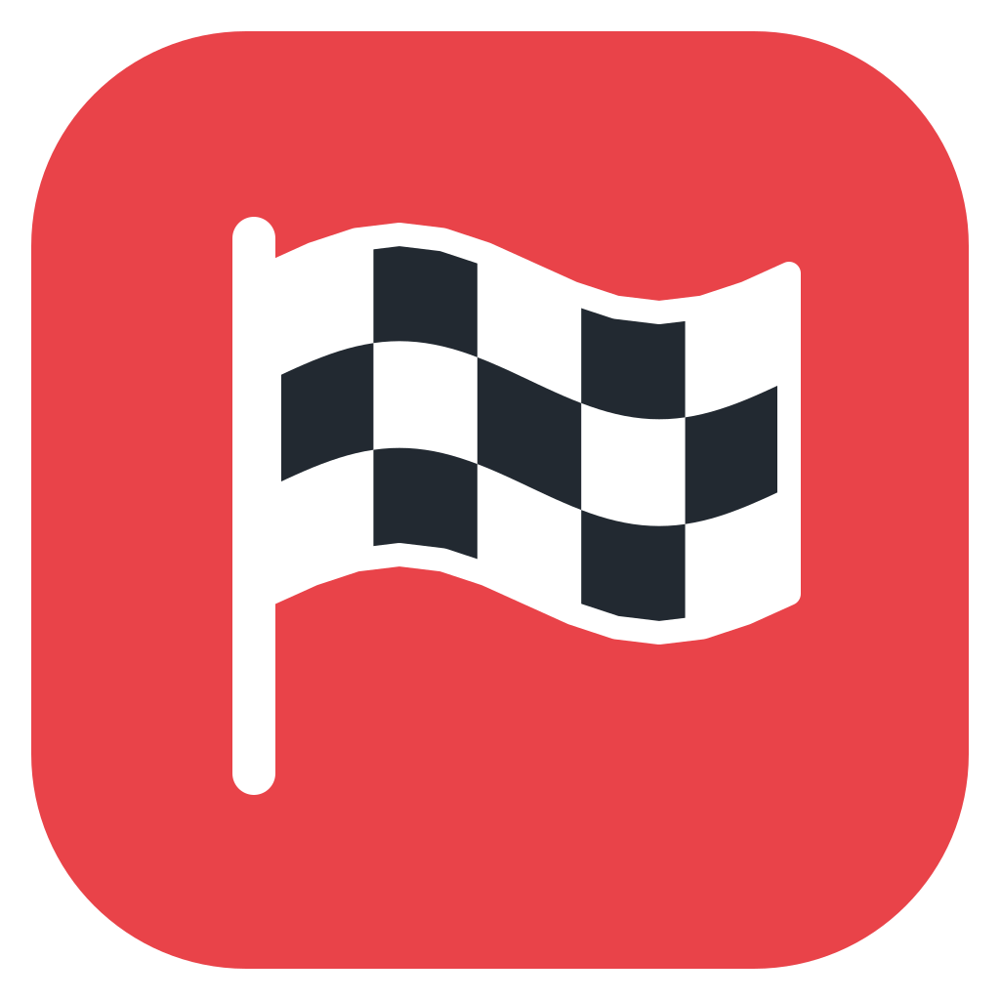
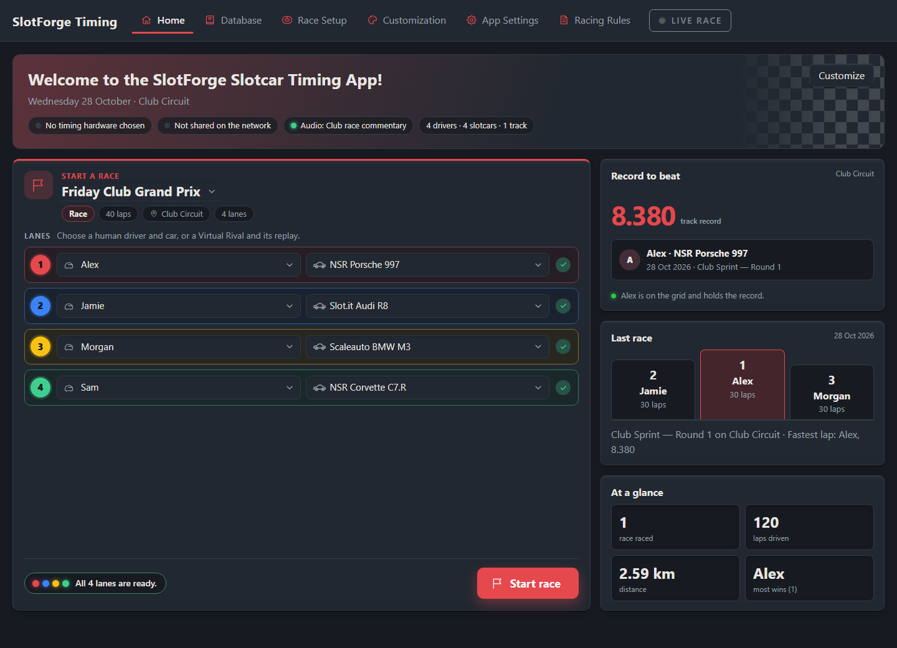
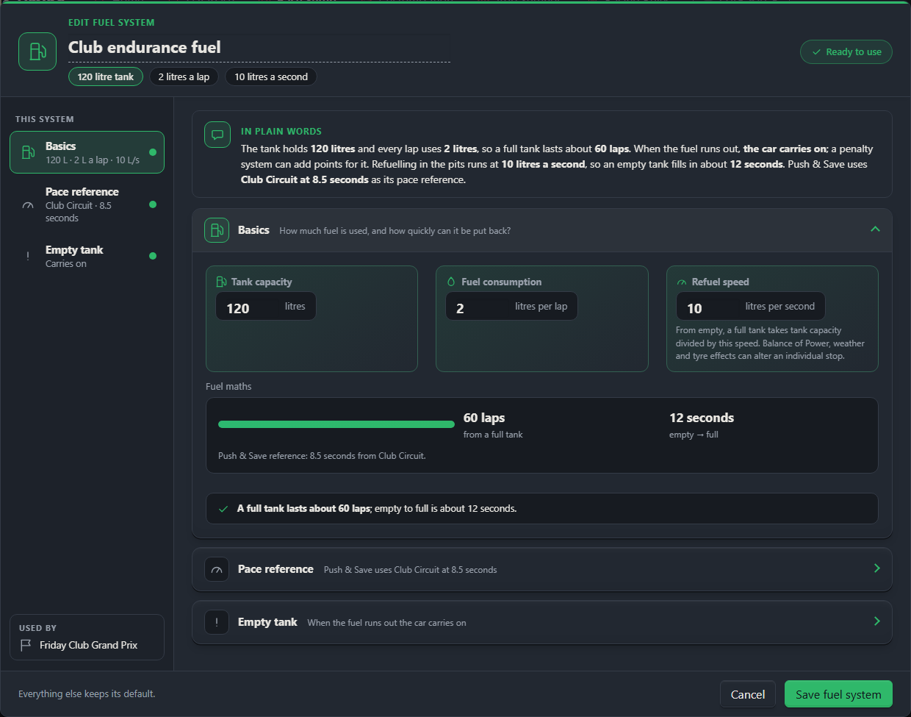
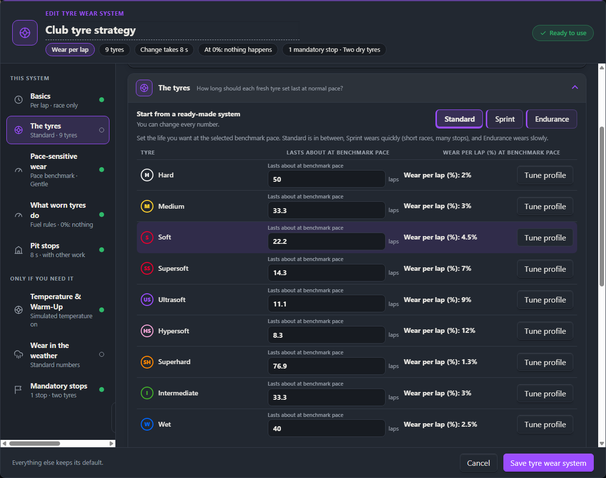
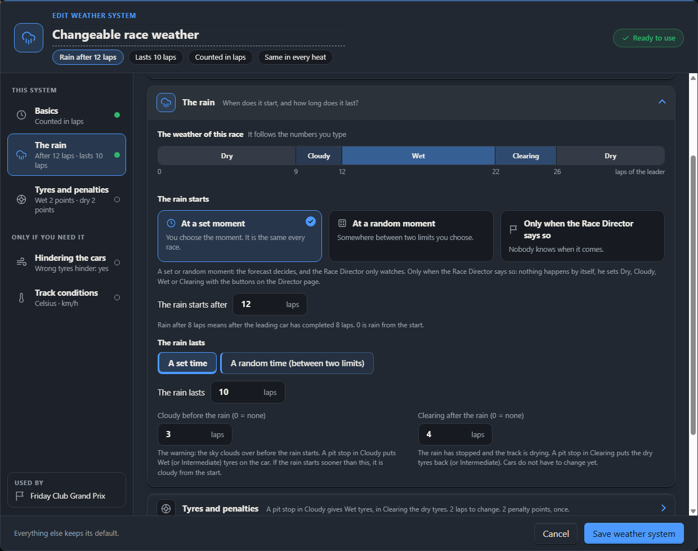
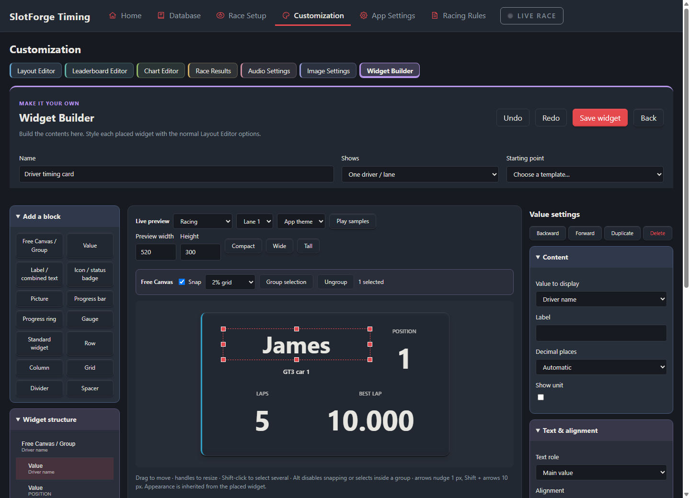
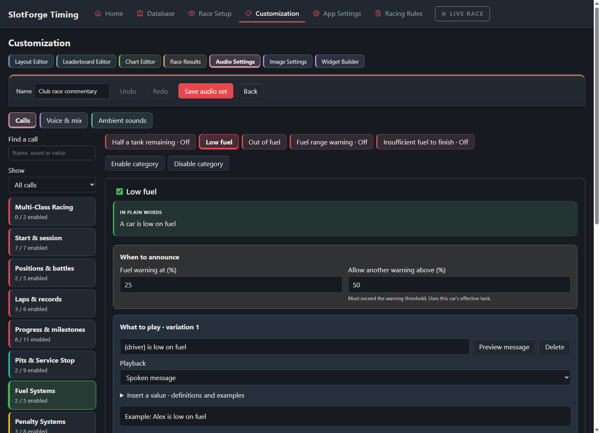
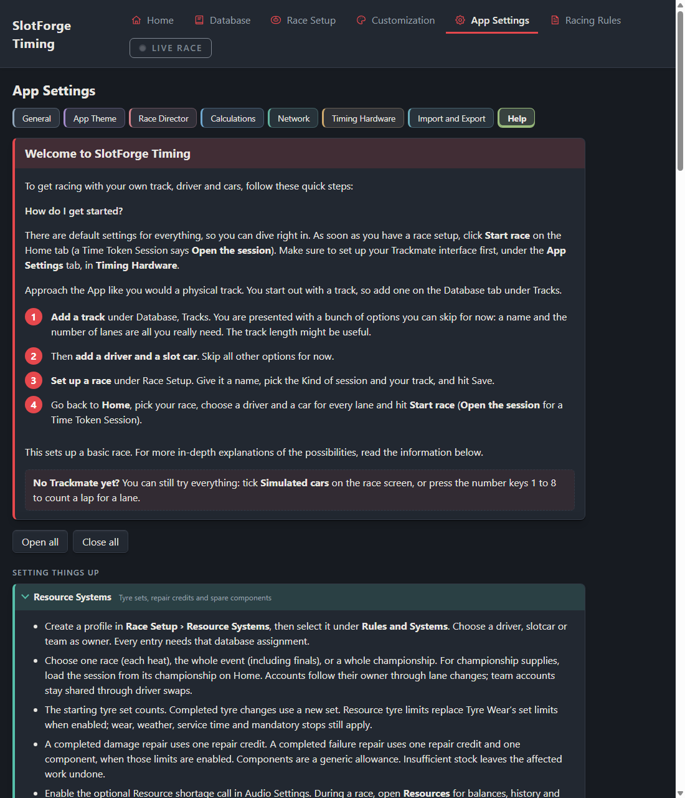

<p align="left">
  
  
</p>
<br clear="both">

# SlotForge Timing

**Time every lap. Run the race your way.**

SlotForge Timing is a desktop lap timer and race-management app for analogue slotcar tracks. Run practice, qualifying, club races, heats, championships and team endurance events. Manage drivers, cars and tracks, add strategic Race Systems, and build the timing screens and commentary that suit your race night.

Use it for a few laps at home or a full club meeting, with live displays on a second monitor, TV or local-network browser. Start with straightforward timing and add fuel, tyres, weather, penalties and other race rules when you want them.

[Download Timing](https://github.com/theDutchmanJames/SlotForgeTiming/releases/latest) · [See the app](#pictures-of-the-app) · [Explore the features](#features-and-functionality) · [How to install](#how-to-install) · [Report a problem](#reporting-problems)

## SlotForge App Collection

SlotForge Timing is part of the **SlotForge App Collection**—apps for building tracks, managing your cars, designing their appearance and exploring their performance.

-  **[SlotForge Paddock](https://github.com/theDutchmanJames/SlotForgePaddock)** — Organize your slotcar collection, photographs, parts, setups and maintenance in a virtual garage and workshop.
-  **[SlotForge Telemetry](https://github.com/theDutchmanJames/SlotForgeTelemetry)** — Explore gearing, motors, tyres and weight, compare setups, and analyse recorded lap times.
-  **[SlotForge Decals](https://github.com/theDutchmanJames/SlotForgeDecals)** — Size and arrange artwork into decal sheets, then export a PDF for printing.
-  **[SlotForge Livery](https://github.com/theDutchmanJames/SlotForgeLivery)** — Plan paint schemes, stripes, race numbers and decals on editable 2D car templates.
-  **[SlotForge Circuit](https://github.com/theDutchmanJames/SlotForgeCircuit)** — Design slotcar tracks, including routed and FreeForm layouts, and export track data for Timing's Live Tracker.

Visit each app's repository for its features, downloads and getting-started guide. Circuit was previously called SlotForge Track Builder; its repository is now SlotForgeCircuit.

## Pictures of the app

[](docs/screenshots/home.png)

*The Home screen with sample club-race data. Click any picture to open it at full size.*

| Fuel Systems | Tyre Wear Systems | Weather Systems |
| :---: | :---: | :---: |
| [](docs/screenshots/fuel.png) | [](docs/screenshots/tyre-wear.png) | [](docs/screenshots/weather.png) |

| Widget Builder | Audio calls | Help |
| :---: | :---: | :---: |
| [](docs/screenshots/widget-builder.png) | [](docs/screenshots/audio-calls.png) | [](docs/screenshots/help.png) |

## Features and functionality

Use SlotForge for a few laps on your home track or a complete club race meeting. Start with basic timing, then choose the extra rules, displays and announcements that suit your event.

### Race formats and competition management

- Run **Free Practice, Qualifying, Races, Heat-based races, Endurance Races and Time Token Sessions**.
- Set races to end by time, laps or distance, with configurable start lights, first-lap behaviour, track calls and red-flag restarts.
- Plan heats and lane rotations, combine results, organise championship rounds and award points.
- Run teams with driver swaps, mixed car classes or recorded Virtual Rivals.
- Review the finished session as Race Director: invalidate or remove laps, disqualify entries and finalise the classification before saving it.
- Show a **Victory Spotlight**, podium cards, configurable driver facts and comparison charts on the Results screen. For larger fields, use a saved leaderboard design.
- Keep personal bests and track records. Laps interrupted by a red flag are marked invalid for records, so coasting during a stoppage cannot create an artificial personal best or track record.

### Race Systems and what they do

Make reusable setups under **Race Setup**, then select the systems you want in a Race Setup. Each system adds its own rules to the shared race engine. You can keep a race simple or combine supported systems for a more strategic event; availability depends on the session format.

| System or setup | What it adds to your race |
| --- | --- |
| **Fuel Systems** | Set tank capacity, fuel consumption, refuelling speed and what happens when the tank runs empty. Use a track's target lap time or a manual reference to configure the system. |
| **Penalty Systems** | Award penalty points and decide their consequences: added time, lap adjustments, forced pit stops or custom combinations. Build escalating points tiers, named special penalties and disqualification rules. |
| **Safety Car Systems** | Configure yellow-flag target pace, penalties for driving too fast, pit-time adjustments and optional random flags with conditions. Track-call power behaviour follows the Race Setup. |
| **Tyre Wear Systems** | Choose standard or custom tyre compounds, wear/lifespan, tyre-changing time, weather suitability, mandatory stops, available sets and warnings. Faster or slower driving can change wear through the configured pace rules. |
| **Tyre Temperature & Warm-Up** | An optional part of Tyre Wear. Simulate cold, working and hot tyres, with compound-specific warm-up, cooling and wear effects. Weather, pits, pauses and completed tyre changes feed into the simulation. |
| **Weather Systems** | Simulate changing weather and track conditions, tyre suitability, wrong-tyre penalties and configurable race effects. Combine them with Tyre Wear, Fuel and other supported rules. |
| **Push & Save Systems** | Make pace affect fuel use, tyre wear or both. Faster laps can cost more resources; slower laps can save them. Set the Push/Save thresholds, benchmark and effect strength. |
| **Damage Systems & car failures** | Apply damage and supported failure events, determine the resulting hindrance, and require repairs or retirement/disqualification under your chosen rules. Repairs integrate with pit service. |
| **Balance of Power** | Help slower cars or hinder faster ones through fuel consumption, refuelling speed and optionally tank capacity. Supports director decisions and automatic balancing; it requires a Fuel System. |
| **Resource Systems** | Limit tyre sets, repair credits and replacement-component supplies for a driver, car or team. Track allocations across a race, event or championship and record director adjustments. |
| **Multi-Class Systems** | Race GT3s, Prototypes or your own classes together or in separate class heats. Select car classes, assign drivers, restrict eligible cars and keep overall/class classifications and points. |
| **Virtual Rival Systems** | Turn saved lap sequences into replay opponents. Link a setup to a Virtual driver, select that driver in a lane, and choose its replay instead of a slotcar. Replays follow the race clock and pause with it; physical timing inputs do not drive the virtual entry. |
| **Rotation Setups** | Build a reusable heat and lane-rotation plan so drivers or teams move through the event in the order you choose. |
| **Championship Setups** | Combine rounds and sessions into a competition with a roster, points tables, bonuses, dropped results, teams and tie-breaking rules. |
| **Time Tokens** | Give each lane an allowance of track time. Add or subtract time, set warnings and show when a lane's time expires. This is a timed-use session rather than a race with a winner; supported lane relays can control lane power. |
| **Endurance & driver swaps** | Race as a team, choose who is driving, define swap windows and minimum driving requirements, and track stints and swap penalties. These controls live in the Race Setup. |
| **Service Stop** | A Race Setup option that works independently of other Race Systems. Hold a pit stop while a car is removed for service, choose timed/manual release and combine fuel, tyres and repairs sequentially or in parallel. A fixed service timer can override calculated work time; penalty time remains additive. |

Tyres, fuel, damage, weather and related effects are race simulations. Their interaction is handled by SlotForge's rules; direct hardware actions depend on the interface and relays connected to your track.

### Design your own race screens

Build your own Race Screens in **Customization → Layout Editor**. Place, move, resize and layer widgets freely instead of being limited to a fixed dashboard. Create separate layouts for the **main screen** and **second display**, from a clean two-lane timing page to a large TV display with race statistics and graphics.

- Choose individual timing, driver, fuel, tyre, weather, penalty, strategy, team and race-control widgets.
- Use **All-in-One widgets** when you want essential driver, timing or race information together without arranging many separate pieces.
- Change fonts, title/value alignment, automatic or manual text sizing, backgrounds, one-colour gradients and gradient angles.
- Configure borders, rounded corners, depth and lane-colour accents at the top, left or right.
- Apply race-state colours to the background, text, or text and border.
- Add lap highlights for crossings, personal bests and track records, with configurable colours and intensity.
- Choose horizontal or vertical fuel and tyre bars, including digital segment styles.
- Use pictures, lane colours, shadows and front/back ordering to build the appearance you want.

### Widget Builder

Create reusable widgets in **Customization → Widget Builder**, starting with a blank canvas or a template. Add values, labels, pictures, icons, conditional status indicators, bars, rings, gauges and supported standard widget components.

Drag and resize individual elements in the live preview. Arrange them freely or use rows, columns, grids and groups. Browse grouped variables, format values and add rules that change an element when its data changes. Save the result, then place it in a Race Screen using the same appearance controls as the built-in widgets.

### Custom Audio Sets

Create different Audio Sets for different race nights or tracks. Configure spoken commentary, custom messages, recorded clips, sound effects and ambient sounds in **Customization → Audio Settings**.

Calls are grouped by race activity and Race System. Insert supported values such as driver names, lap times, positions, gaps and system status into messages. Choose playback modes, conditions, repeat limits, voice/mix options and which calls are enabled. Link the Audio Set to a Race Setup so the right announcements load with the event.

### Leaderboard Editor

Design the rows of your leaderboard: choose which values to show, their order, widths, labels, colours and presentation. Reuse a saved design in **Leaderboard widgets**, the **Live Race leaderboard** and the **Race Results list**. Configure overall, class-specific or grouped class views where supported.

### Chart Editor and live comparisons

Create a saved chart design in **Customization → Chart Editor**, then place a Race Chart widget in a layout or use it as a supported Widget Builder component. Choose drivers, values, lap history, references, legends and display options.

Chart styles include **Lap Trend, Driver Comparison, Delta Trend, Lap Time Spread (box plot), Lap Time Distribution (histogram), Position History, Lap Heatmap and Live Track**. Live Track shows estimated progress from lap timing; it is not a physical position sensor. It uses the shared, throttled display-update path rather than adding an unrestricted animation loop per chart.

### Custom Image Sets

Create reusable **Image Sets** in **Customization → Image Settings** and assign them to compatible widgets. Use your own artwork for supported elements such as driver avatars, tyres, start lights, fuel indicators and weather graphics. A saved set makes it easier to keep matching visuals across several layouts.

### Make Timing your own

Make SlotForge look and feel like your own app. Choose a ready-made theme or give the app the colours you want, add your own **logo and header images**, and coordinate the Race Screens, widgets and image sets. Build a personal style for your home track, or match your **club or company branding**. The app's [licence terms](#license-and-copyright) govern its use.

### Keep drivers, cars and tracks together

Keep drivers, teams, slotcars and tracks together with their pictures, descriptions, class labels and settings. Track records and personal bests stay linked to the people, cars and tracks that produced them.

The **Slotcar Database** includes more than a car list. View laps driven, mileage, sessions, wins, last use, fastest laps, per-track lap statistics, service intervals and mileage/laps since servicing. Deslot estimates use the track's configured lap-time threshold. Set a **Race Class** label, such as GT3 or Prototype, to make the car available to the matching Multi-Class entries.

### Bring your Circuit track into Live Track

Import a **SlotForge Circuit** design into the Track Database, including its name, lane lengths, artwork and supported route/tuning data. Circuit was previously called SlotForge Track Builder.

The **Live Track** chart follows the imported lane shapes. Choose the original coloured-lane appearance or the track's imported artwork, and use its supported tuning profile to shape the cars' estimated movement. The tracker visualises lap-timing estimates; it does not measure a car's physical position between sensors. [Track import and Live Track guide](docs/TRACK-BUILDER-INTEGRATION.md).

### Race cars from SlotForge Paddock

Start **Dealership hosting** in Paddock, then open **Database → Slotcars → Dealership Cars** in Timing. Find the host on your local network or enter its displayed address and port, and connect with its **Dealership password**. These controls and result delivery are also available in **App Settings → Connections → Dealership Mode**.

- Switch between **Slotcar library** and **Dealership Cars**. Browse Paddock cars directly when assigning entries on Home; selected cars are cached automatically.
- Keep catalogue specifications, pictures and Race Class connected to Paddock while Timing retains its own simulation settings and local race history.
- Finalize the Race Director's reviewed results to save the session and queue delivery back to Paddock. Failed connections leave results waiting for retry; delivered revisions and withdrawals prevent duplicate or stale statistics.
- Race offline with previously cached configurations. Historical results retain the car configuration captured for that race.

Catalogue checks refresh changed data while browsing and pause during racing. For an independent copy instead of a live connection, export cars from Paddock in **SlotForge Timing** format and import them through **App Settings → Import and Export**. Repeated file imports create new copies.

The connection uses Paddock's **Timing v1 API**; capabilities depend on the host. Overall classifications are delivered, while separate Multi-Class awards remain in Timing. Virtual rivals do not add physical mileage. [Connection, delivery and compatibility guide](docs/PADDOCK-INTEGRATION.md).

### Import, Export and sharing between users

**App Settings → Import and Export** lets users freely share **Widgets, Layouts and custom Audio and Image Sets** with each other. Export a design or a collection, send the file to another user, and let them import it into their own app—there is no need to exchange the entire database.

You can also export drivers, slotcars, tracks, teams, Race System setups, championship setups, leaderboard designs, chart designs and saved sessions. Choose the related items to include, such as an Image Set used by a layout. **Individual imports add copies**, preserving links between the included items; a conflicting name gets an imported suffix.

For moving a complete installation's data, create a **Complete backup**. It includes the database, layouts, pictures, sounds, settings, past races and laps. **Restoring a complete backup replaces the current database**, so use an individual export when your aim is simply to add another user's designs. Complete backups also include settings such as the Race Director password; individual design exports are the appropriate files for sharing publicly.

### Content Packs and code plugins

**App Settings → Import and Export → Content Packs** lets you install and share collections of layouts, Widget Builder designs, leaderboard and chart designs, Image Sets, Audio Sets, colour themes and supported Race System presets. Review a pack, then add editable copies to your normal editors or explicitly apply its theme. Updates and removal preserve your existing copies. Create packs from your saved content without writing code.

Content Packs add reusable content through the existing importer, with compatibility checks, manual updates and library rollback. Review a pack before applying its theme or creating editable copies. Back up installed packs separately; copied designs are included in normal database backups. [Content-pack guide and example](docs/content-packs.md).

**Code plugins** extend the app through **App Settings → Plugins**. They can provide:

- Generated settings, commands, logs, local storage and recovery controls. [Runtime API](docs/PLUGIN-RUNTIME.md).
- Timing drivers with lap/pit sensors, track calls and supported power/light outputs. [Timing-driver API](docs/PLUGIN-TIMING.md).
- Lane/race widgets, pages and tools. Add widgets from the Layout Editor's **Plugins** folder and open pages under **Customization → Plugin Pages & Tools**. [Display API](docs/PLUGIN-DISPLAYS.md).
- Race rules with fuel/tyre modifiers, lap-time consequences and competition-point bonuses, selected in a Race Setup. [Rule API](docs/PLUGIN-RULES.md).

Installing a plugin does not start it. Run code only when you trust its author: background plugins have your operating-system access. Third-party code stays separate from the standard app build, and shared layouts reference plugins without bundling their executable code.

### Help and calculations explained

The in-app **Help** has grouped, expandable sections covering race preparation, Race Systems, hardware, editors, results and day-to-day workflows. Setup pages also provide **IN PLAIN WORDS** summaries, explanations, tooltips and previews.

**App Settings → Calculations** explains the documented formulas and worked examples behind pace benchmarks, fuel, tyres, race effects, resource allocation, pit service, penalties, timing estimates and scoring. Explore available choices such as median or average pace and save supported calculation settings. The page distinguishes examples from settings that actually change race behaviour; it is not an unrestricted code editor.

### Second screens, local-network viewing and race control

Display live timing and results on another monitor or TV, or let devices on the same local network follow a race in their browser. The Race Director can manage calls, penalties, pit service and supported Race System controls while racing. Remote director access uses the password configured in App Settings.

Use **Needs Attention** for current warnings and required actions, and **Recent Events** for a timeline of what happened. Both widgets live in the **Pit Stops** folder and bring race and system information together for a quick glance.

### Connect your timing hardware

Choose the active interface in **App Settings → Timing Hardware**. One interface supplies race timing at a time.

| Interface | Support in this version |
| --- | --- |
| Trackmate | Serial connection, lane mapping, track calls and supported relay control. |
| Arduino Sketch | SlotForge firmware for compatible Nano/Mega boards, sensors, pits, lights, relays and buttons. A virtual box is available for simulation. |
| Parallel Port | Windows native LPT/compatible expansion hardware through a separately installed compatible InpOut driver. A USB printer adapter does not provide the required direct pin access. |
| DS Electronics | DS-200 (2 lanes) and DS-300 (up to 8 lanes) race timing, with capture diagnostics. Timing controls starts and resumes; no DS power control. Replay-tested; physical hardware verification is outstanding. Other DS models remain capture-only. |
| oXigen Digital | Reserved interface page; not implemented yet. |
| Plugin Interface | Separately installed timing drivers can provide sensors, track calls and supported power/light controls. |
| No hardware | Keyboard/manual controls and simulated cars for trying the app. |

Parallel Port support has been tested in software with simulated inputs. Physical hardware compatibility and timing accuracy have not been verified for this implementation. Check the interface documentation before connecting a track:

- [Parallel Port setup and requirements](docs/PARALLEL-PORT.md)
- [Arduino box documentation](docs/arduino-box/)
- [Service Stop behaviour](docs/SERVICE-STOP.md)

## How to install

Open the **[latest release](https://github.com/theDutchmanJames/SlotForgeTiming/releases/latest)** and expand **Assets**. Choose the finished app for your computer. **Desktop downloads need no Node.js, coding or terminal commands.** The source ZIP and GitHub's automatic Source code downloads are for building it yourself.

| Your computer | Choose this download |
| --- | --- |
| **Windows · Intel/AMD 64-bit** | **Portable.exe** to try the app, or **Setup.exe** to install it for regular use. |
| **macOS** | Use a Mac DMG or ZIP only when listed in that release's assets. **mac-x64** supports Intel; **universal** supports Intel and Apple Silicon. Check the release notes for the build provided. |
| **Linux · Debian/Ubuntu-based, Intel/AMD 64-bit** | **.deb**, opened with your package installer. |
| **Linux · other compatible distributions, Intel/AMD 64-bit** | **.AppImage**, with permission to execute enabled. |

### Windows: try Portable, then install if you like it

1. Download the file ending in **Portable.exe**. If supplied inside a ZIP, extract it first.
2. Double-click it and explore Timing without installing. Choose **None** under Timing Hardware, or use the Arduino virtual box to try simulated inputs.
3. If you like the app and want to use it long term, download **Setup.exe**, run it and follow the installation wizard. Use the installed shortcut for everyday racing.

Windows downloads are unsigned. If Windows displays a security prompt, check that the file came from this repository before choosing any option to run it. Hardware may require its own drivers or libraries.

### macOS

1. Check the release notes and assets for a Mac build compatible with your computer, then download and open its **.dmg**. If that release has no Mac download, keep your existing version until a compatible build is available.
2. Drag **SlotForge Timing** into **Applications**.
3. Open it from Applications, then eject the disk image.

The Mac app is ad-hoc signed, not Apple Developer ID signed or notarized. If macOS blocks the first launch, use **System Settings → Privacy & Security → Open Anyway** if offered and you trust the download. The ZIP is an alternative: extract it and move the app into Applications.

### Linux

**Debian/Ubuntu-based systems:** open the **.deb** with your software/package installer, choose **Install**, then launch Timing from the applications menu.

**AppImage:** save the file, open **Properties → Permissions**, enable **Allow executing file as program** or your distribution's equivalent, then double-click it. AppImage support depends on your distribution and FUSE configuration; the DEB is an alternative on Debian-based systems.

Parallel Port requires **Windows**. Other interfaces depend on suitable OS drivers and access to their serial/network hardware. See [native build and platform details](docs/DESKTOP-RELEASES.md).

### Run or build from source

For new users building the source, start with the **Quick Build files**. They skip the automated checks while installing missing build dependencies and packaging the app. The regular build scripts run the checks first.

The **[complete source guide](docs/BUILDING-FROM-SOURCE.md)** explains Node.js installation, extracting the correct folder, double-click builds and complete terminal command blocks. It starts from any terminal folder, checks the project before running npm, and supports paths containing spaces or a different drive.

### Your first race

1. Open **Database** and add your track, drivers and slotcars. Set a car's **Race Class** if you plan to use Multi-Class racing.
2. Open **App Settings → Timing Hardware**, choose the interface and check its lane sensors. To explore without hardware, choose **None** or the Arduino virtual box.
3. Create a **Race Setup**, select the track and session type, and choose the finish rule. Add optional Race Systems as needed.
4. On **Home → Start a Race**, assign drivers and cars to lanes. For a Virtual Rival driver, the car selector becomes the saved replay-setup selector.
5. Start the session. After it ends, review the laps and classification on the director's finalize-results page before saving the results.
6. Configure timing layouts, leaderboard rows, charts, widgets and the Results screen under **Customization**.

Open **App Settings → Help** whenever you need an explanation. **App Settings → Calculations** provides worked examples of the race rules and the settings that control them.

### Updating, backups and moving computers

The app keeps its database in its user-data folder, separately from the source and installed program. On Windows this is normally:

```text
%APPDATA%/slotforge-timing/
```

New installations use SQLite. Existing JSON users are offered **Convert and continue**, **Remind me in a week**, or **Keep using JSON**. Conversion verifies a separate copy and retains the original JSON files. After switching, new changes go only to SQLite; the retained JSON is a recovery copy, not a current backup. You can convert later under **App Settings → General → Database storage**, which also shows the active database path. Allow space for the originals, recovery copy and SQLite database.

Before updating, create a complete backup through **App Settings → Import and Export**, close Timing, then install or open the new release. Make a backup before moving to another computer or replacing an existing database. The portable executable also uses the app's normal user-data folder; it does not make a separate database alongside the executable.

## Reporting problems

Open a [GitHub issue](https://github.com/theDutchmanJames/SlotForgeTiming/issues) and include:

- Your app version and operating system.
- What you expected, what happened, and the steps needed to reproduce it.
- A screenshot and the exact error message, if one appears.
- For timing problems: interface/model, affected lane, sensor configuration and enabled Race Systems.
- For display problems: window size, interface scaling, theme and a sample layout/widget export if relevant.
- For Paddock or Circuit connections: the other app's version and the operation that failed.

Use sample data or a small export where possible. Remove connection passwords and private information before sharing files. The in-app **Help** and [source-build troubleshooting](docs/BUILDING-FROM-SOURCE.md#common-first-time-setup-problems) may answer setup questions.

## License and copyright

SlotForge Timing is made by theDutchmanJames. Copyright 2026 theDutchmanJames.

SlotForge Timing is provided under the **SlotForge Source-Available License 1.0 — No Software Sales or Paid Access**.

- Personal, educational, club and internal business use are permitted without charge.
- You may study, modify and share free copies, keeping the licence and notices and identifying your modifications.
- Selling the app, including modified versions or copies bundled into paid offerings, or charging for access requires separate written permission.
- You may use or sell your own original widgets, layouts, audio/image sets and race reports, subject to any rights in included third-party material. This does not permit selling the app itself.
- Voluntary donations are allowed when access and use do not depend on payment.

See [LICENSE](LICENSE) for the full terms. Third-party components retain their own licences. For an older release, check the licence included with that download.
