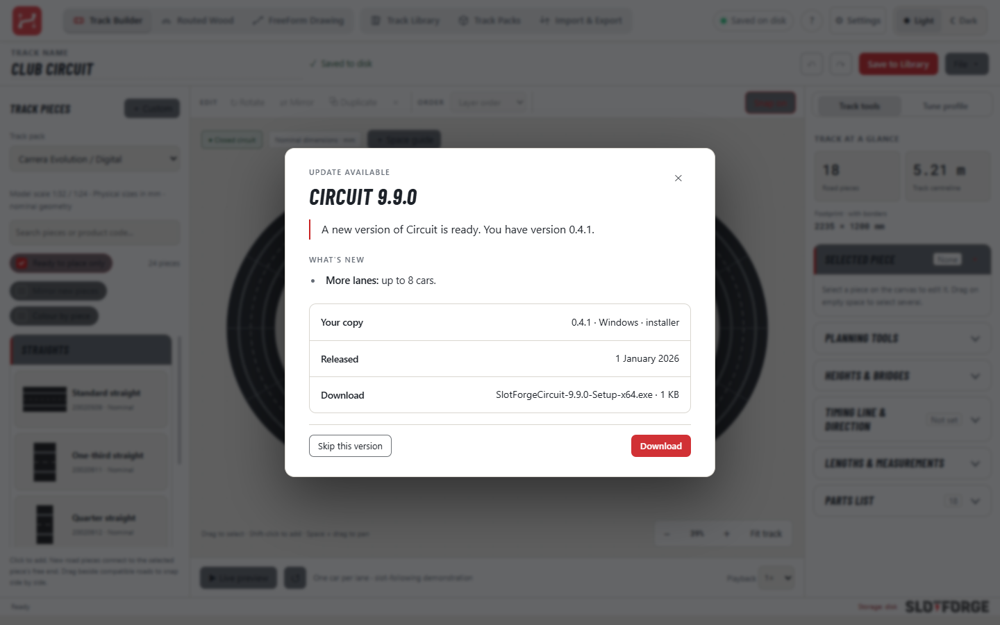

# Handoff: the update check (for every SlotForge app)

This is how SlotForge Circuit tells people about a new version. Build it the same way in the
other SlotForge Electron apps (Timing, Paddock, …), so every app behaves and looks alike.

The reference is Circuit's working tree at `C:\Users\theDutchmanJames\Documents\CLAUDE\Circuit`.
Copy the four files below **as they are**. Only the options in [Set your app's names](#3-set-your-apps-names)
change per app, never the code.



---

## 1. What it does (the behaviour to keep)

1. **Once, at start.** About 5 seconds after the app opens, it asks GitHub for the latest
   release. There is no timer after that: the next check is at the next start.
2. **Nothing new: nothing happens.** No message, no notice.
3. **A newer version: a window opens.** If another window is already open (the welcome screen on a
   first start, for example), it waits until that one is closed.
4. **The window shows:**
   - a trail `UPDATE AVAILABLE` and the title `<App> <version>`;
   - a lead: "A new version of `<App>` is ready. You have version `<x>`.";
   - **What's new**: the short section from the release notes;
   - **Your copy**, **Released** and **Download** (file name · size) as rows.
5. **Two answers:**
   - **Skip this version:** no window for that version again. The next newer version shows it again.
   - **Download:**
     - fetches the file that matches **this copy** into the Downloads folder;
     - checks its size and SHA-256 fingerprint;
     - shows a progress bar with **Cancel**;
     - then "Saved in Downloads", a one-line "how to install" for this kind of copy, **Show in folder** and **Close**.
6. **Closing the window** (✕ or Esc) only hides it for this session; it comes back at the next start.
7. **No automatic update.** This is a decision, not a gap. The app never runs, opens or installs
   what it downloads. (The Windows builds are unsigned; a silently started installer may be
   blocked by Smart App Control or SmartScreen.)

**Settings → Updates** (a Settings Sheet section) has these rows:

- This version, with the kind of copy;
- Newest version, as a pill;
- Last checked;
- **Check when `<App>` starts**, a switch;
- **Check now**: it always opens the window when there is a newer version, even a skipped one;
- when there is a newer version, a button that opens the window again.

**The file for this copy**

| This copy            | File it downloads                                           |
| -------------------- | ----------------------------------------------------------- |
| Windows installer    | `<Prefix>-X.Y.Z-Setup-x64.exe`                              |
| Windows portable app | `<Prefix>-X.Y.Z-Portable-x64.exe`                           |
| macOS                | `<Prefix>-X.Y.Z-mac-universal.dmg` (else `-mac-<arch>.dmg`) |
| Linux AppImage       | `<Prefix>-X.Y.Z-linux-x86_64.AppImage` (`arm64` on ARM)     |
| Linux .deb           | `<Prefix>-X.Y.Z-linux-amd64.deb` (`arm64` on ARM)           |

**How the copy is detected:**

- the portable app has `PORTABLE_EXECUTABLE_FILE` set (electron-builder sets it);
- an AppImage has `APPIMAGE` set;
- otherwise it is the installer (Windows) or the .deb (Linux).

**When a copy is told:** only once its own file is attached to the release. The macOS and Linux
files are built after publishing, so those copies hear about it a little later.

---

## 2. The files

| File in Circuit                 | Where it runs       | Copy                                     |
| ------------------------------- | ------------------- | ---------------------------------------- |
| `desktop/update-check.cjs`      | main process        | as is                                    |
| `app/update-ui.js`              | the page (renderer) | as is                                    |
| `app/update-window.css`         | the page            | as is                                    |
| `desktop/update-check.test.cjs` | `node --test`       | as is; it also tests another app's names |

**Plus small additions to three existing files** (section 4):

- `desktop/preload.cjs`: two functions;
- `desktop/main.cjs`: the wiring;
- the page: load the script and stylesheet, and call `UpdateUI.start(…)`.

**The interface test to copy:** in `desktop/ui-tests.cjs`, the test
"a newer release opens the update window: What's new, Skip, and Download into Downloads".

---

## 3. Set your app's names

`UpdateCheck` (main process) options. Circuit's values are the defaults:

| Option           | Circuit                   | Example for Timing              |
| ---------------- | ------------------------- | ------------------------------- |
| `appName`        | `'Circuit'`               | `'Timing'`                      |
| `artifactPrefix` | `'SlotForgeCircuit'`      | `'SlotForgeTiming'`             |
| `userAgent`      | `'SlotForge-Circuit'`     | `'SlotForge-Timing'`            |
| `homepage`       | `package.json` `homepage` | the app's GitHub repository URL |

`UpdateUI.start` (page) options:

| Option    | Circuit                             | Example for Timing                             |
| --------- | ----------------------------------- | ---------------------------------------------- |
| `appName` | `'Circuit'`                         | `'Timing'`                                     |
| `keeps`   | `'your tracks stay where they are'` | `'your races and drivers stay where they are'` |

`artifactPrefix` must match the start of the release file names from electron-builder's
`artifactName` (for example `"SlotForgeTiming-${version}-Setup-${arch}.${ext}"`).

---

## 4. Wiring

### Main process (`desktop/main.cjs`)

```js
const { UpdateCheck } = require('./update-check.cjs');

const automated = !!(process.env.SLOTFORGE_DESKTOP_SMOKE || process.env.SLOTFORGE_UI_TESTS);
const updateCheck = new UpdateCheck({
  profile: app.getPath('userData'),
  current: app.getVersion(),
  homepage: require('../package.json').homepage,
  appName: 'Timing', // ← your app
  artifactPrefix: 'SlotForgeTiming', // ← your app
  userAgent: 'SlotForge-Timing', // ← your app
  fetch: (url, init) => net.fetch(url, init),
  // Development copies, automated runs and SLOTFORGE_NO_UPDATE_CHECK only check when asked.
  automatic: app.isPackaged && !automated && !process.env.SLOTFORGE_NO_UPDATE_CHECK,
  edition: {
    platform: process.platform,
    arch: process.arch,
    portable: !!process.env.PORTABLE_EXECUTABLE_FILE,
    appImage: !!process.env.APPIMAGE,
  },
  downloads: app.getPath('downloads'),
  onChange: () => {
    if (win && !win.isDestroyed()) win.webContents.send('update:changed');
  },
});
let updateTimer = setTimeout(() => void updateCheck.startupCheck(), 5 * 1000);
updateTimer.unref();

ipcMain.handle('update:action', async (event, action, payload) => {
  // Only the app's own page may ask (origin = the address the app's page is served from).
  try {
    if (new URL(event.senderFrame?.url || '').origin !== origin) return { error: 'Unknown page.' };
  } catch {
    return { error: 'Unknown page.' };
  }
  try {
    if (action === 'status') return { ok: true, value: updateCheck.status() };
    if (action === 'check') return { ok: true, value: await updateCheck.check() };
    if (action === 'enable') return { ok: true, value: updateCheck.setEnabled(payload?.enabled) };
    if (action === 'skip') return { ok: true, value: updateCheck.skip(payload?.version) };
    if (action === 'download') {
      // Not awaited: progress and the result reach the window through update:changed.
      updateCheck.startDownload().catch(() => {});
      return { ok: true, value: updateCheck.status() };
    }
    if (action === 'cancel') return { ok: true, value: updateCheck.cancelDownload() };
    if (action === 'show') {
      shell.showItemInFolder(updateCheck.downloadedFile());
      return { ok: true, value: { shown: true } };
    }
    if (action === 'open') {
      await shell.openExternal(updateCheck.releaseUrl());
      return { ok: true, value: { opened: true } };
    }
    throw Error('Unknown update action.');
  } catch (e) {
    return { error: e.message, code: e.code };
  }
});

// When the app quits:
clearTimeout(updateTimer);
updateCheck.stop(); // abandons a check or download in progress
```

If the app's page is a `file://` page rather than a local server, check `event.senderFrame.url`
against that page's URL instead of an origin. Keep the check: only the app's own page may ask.

### Preload (`desktop/preload.cjs`), inside the `contextBridge.exposeInMainWorld` object

```js
// Update check (Settings → Updates and the update window); resolves to { ok, value } or { error }.
updateCheck: (action, payload) => ipcRenderer.invoke('update:action', String(action), payload),
onUpdateChange: callback => ipcRenderer.on('update:changed', () => callback()),
```

`update-ui.js` reads these from `window.slotforgeDesktop`. If your app exposes another name, change
the one line `const desktop = root.slotforgeDesktop;` in `update-ui.js`, and note the change here.

> **Timing:** its preload exposes `window.api`, so its `update-ui.js` reads `const desktop = root.api;`. Timing also reads its
> version from `package.json` (not `app.getVersion()`, which reports Electron's own when the app is started through another script),
> keeps its files at `update-check.cjs` (main), `renderer/update-ui.js`, `renderer/update-window.css` and `tests/update-check.test.cjs`,
> and its preload keeps one `update:changed` listener at a time (App Settings is drawn again and again).

### The page

```html
<link rel="stylesheet" href="update-window.css" />
<!-- after the app's main styles -->
<script src="update-ui.js"></script>
```

```js
UpdateUI.start({
  settings: document.getElementById('settings-view'), // where the Updates section goes
  before: document.getElementById('app-theme-settings'), // optional: insert before this element
  say: (message, isError) => showStatus(message, isError), // the app's status line
  appName: 'Timing',
  keeps: 'your races and drivers stay where they are',
});
```

The browser edition has no `slotforgeDesktop.updateCheck`, so `UpdateUI.start` does nothing there.

---

## 5. Styling it relies on

`update-window.css` holds everything specific to the window. It sits on the SlotForge Restyle
basics that every restyled app already has:

- **Colour tokens:** `--bg`, `--panel`, `--ink`, `--muted`, `--line`, `--accent`, `--ui-focus`,
  `--ui-success`.
- **The dialog base (Workshop Window):** `dialog`, `.dialog-heading`, `.dialog-actions`
  (buttons on the right, the line above them).
- **Buttons (Pit Buttons):** `.btn`, `.btn.primary` (Download, Show in folder),
  `.btn.ghost` (Skip this version), `.btn.quiet` (✕).
- **Settings Sheet rows:**
  - in the window and the Settings section: `.ss-sheet`, `.ss-row`, `.ss-t`, `.ss-ctl`, `.ss-desc`, `.ss-note`, `.ss-note.warn`;
  - in the Settings section only: `.ss-section`, `.ss-pill.good` / `.ss-pill.needs`, `input.ss-switch`.
- **Fonts:** the Barlow Condensed title font on `h2` (Type Trio) and Roboto Mono through
  `--font-numbers` (the download progress).

If an app is missing one of these, copy that block from Circuit's `app/style.css` (search for its
SlotForge Restyle comment: "Workshop Window", "Pit Buttons", "Settings Sheet"), not just the
update window.

**Keep the "What's new" heading an `h4`.** Some apps style `h1`–`h3` with the big italic title
font, which made a tiny italic heading here.

---

## 6. Release notes: the "What's new" section

The window reads **only** the lines under a heading `## What's new` (any level, `What’s` with a
curly apostrophe too), up to the next heading:

- **Format:** shown as plain text. Bold, links, code marks and HTML are removed; nothing in the
  notes can run.
- **Length:** at most six lines, each cut at about 280 characters.
- **Titles:** a line `- **Name:** text` shows the name in bold.

So write for users, short, one change per line. Put anything "under the hood" under another
heading (for example `## Verification` or `## Details`):

```markdown
A short sentence about this release.

## What's new

- **One car per lane:** Live preview drives a car on every lane, up to 8.
- **Calmer look:** new type, buttons and side lists throughout the app.

## Verification

57 unit test files passed on Windows, macOS and Linux.
```

Circuit's rule lives in `docs/releases/README.md`; give each app the same file.

**The release also needs:**

- **Files:** the download for every copy attached, with the exact names from section 1.
- **Fingerprints:** GitHub lists a SHA-256 for each file by itself (the asset's `digest`). The
  app checks it when it is there; without it, the size alone is checked.
- **Version tags:** a published release (not a draft or pre-release) with a tag like `v1.2.3`.
  Tags like `1.2.3-beta` are ignored.

---

## 7. Safety rules (do not loosen)

- **What is sent:** only `GET https://api.github.com/repos/<owner>/<repo>/releases/latest`, with
  the User-Agent `<userAgent>/<version>`. Nothing about the user or their data is sent.
- **The answer is untrusted:**
  - answers over 1 MB are refused;
  - drafts and pre-releases are refused;
  - the tag must be `vX.Y.Z`;
  - file names must be `<Prefix>-<that version>-<letters>.<ext>`;
  - sizes must be whole numbers up to 1 GB.
- **Addresses are built, never taken from the answer.** The download address is
  `https://github.com/<repo>/releases/download/<tag>/<name>` and the release page is
  `https://github.com/<repo>/releases/tag/<tag>`. `browser_download_url` and `html_url` are ignored.
- **While downloading:**
  - the file is written as `<name>.part`;
  - it fails if it grows past the listed size, ends short, or stops receiving for a minute;
  - its SHA-256 must match;
  - only then is it renamed. A failed or cancelled download leaves nothing behind.
- **Never run or open the download.** Show in folder only reveals it.
- **IPC:** `update:action` answers only the app's own page.
- **Saved state:** `update-check.json` in the profile (`userData`), written through a `.tmp` file
  and re-checked when read. A damaged or odd file falls back to safe defaults.
  - Fields: `enabled`, `lastCheck`, `latest` (version, tag, date, notes, files), `skipped`, `lastError`.

---

## 8. The status the page gets

`status()` (and every action) returns:

```js
{
  enabled, automatic, current,               // switch on, checks at start in this build, this version
  kind, kindLabel,                           // 'setup' | 'portable' | 'mac' | 'appimage' | 'deb', and 'Windows · installer' …
  latest: null | { version, publishedAt, notes: [{ title?, text }], file: null | { name, size, sha256? } },
  upToDate, notify,                          // notify: open the window by itself
  lastCheck, lastError, checking,
  download: { state: 'idle' | 'downloading' | 'done' | 'failed', name, received, total, file, error },
}
```

`notify` is true when all of these hold:

- the check at start is on;
- there is a newer version;
- the file for this copy is attached;
- that version is not skipped.

---

## 9. Tests

**Unit** (`node --test desktop/update-check.test.cjs`, 22 tests) cover:

- the version order;
- one request to the right address;
- up to date, and after updating;
- Skip;
- once at start (and never when off or in development);
- bad answers;
- a damaged settings file;
- built addresses;
- waiting for this copy's file;
- quitting during a check;
- What's new parsing;
- the right file for each copy;
- a checked download, and removing files that do not match;
- cancelling;
- remembering and re-checking saved state;
- another app's names.

**Interface** (the window in the real app, with GitHub replaced by a fake answer) checks:

- the window opens with the right title;
- What's new without the technical section;
- the kind of copy;
- no stray words;
- the two buttons;
- Download saves the exact file;
- Settings shows the version;
- Check now reopens it;
- Skip keeps it away;
- a newer version shows it again.

**Seeing it:** set `SLOTFORGE_UI_SHOTS` to a folder and run that test. It saves pictures of the
window in the dark and light themes and after the download (`h.shot(name)` in the test harness).

**Lessons from building it in Circuit:**

- **Tests must not call `startupCheck()`.** It is off in automated runs on purpose, so a test calls
  `check()` (the same code) instead.
- **A finished download is remembered until the app restarts.** Reloading the page alone still
  shows "Saved in Downloads", so a test that needs Skip again resets `download` to
  `{ state: 'idle' }`, as a restart would.
- **`replaceChildren(null)` writes the word "null".** Leave out empty parts first, which the code
  already does.
- **Progress redraws only the bar and its words**, so the keyboard focus stays on Cancel.

---

## 10. Checklist for a new app

1. Copy the four files from section 2.
2. Add the main-process wiring, the preload functions and the page hooks (section 4) with your
   app's names (section 3).
3. Check the styling basics are there (section 5).
4. Check `artifactName` in `package.json` gives the names in section 1.
5. Add `docs/releases/README.md` and a `## What's new` section to the next release notes.
6. Run the unit tests and the interface test. Look at the window in both themes.
7. Remove the app's old update notice, its interval timer and its styles, if it had them.
